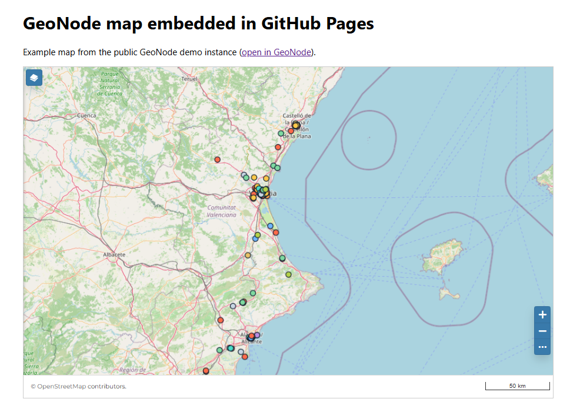
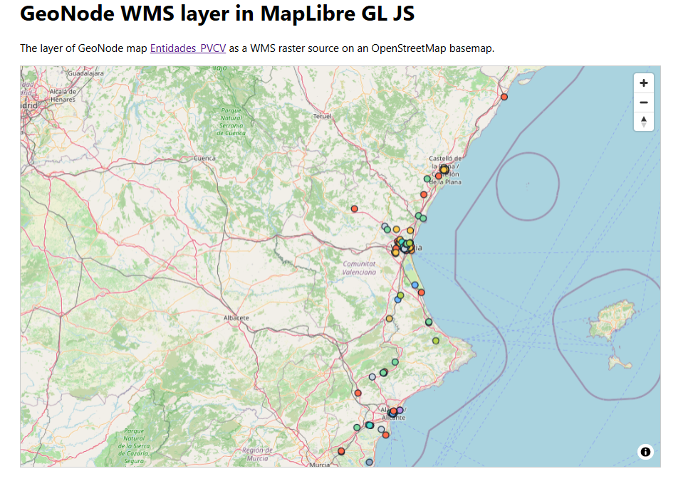

# Embed a GeoNode map in an external site

This repository shows how to embed a map created in [GeoNode](https://geonode.org) in an external static HTML page. The examples use map [Entidades_PVCV](https://stable.demo.geonode.org/catalogue/#/map/19196) from the public demo instance `stable.demo.geonode.org`.

Live demos:

- Overview: https://bertt.github.io/geonode_embed_map/
- Option 1 (iframe): https://bertt.github.io/geonode_embed_map/iframe.html
- Option 2 (MapLibre, WMS + GetFeatureInfo): https://bertt.github.io/geonode_embed_map/maplibre-popup.html

> Demo instances are reset periodically. If the example map is gone, pick another one from https://stable.demo.geonode.org/catalogue/#/maps and update the URL in `iframe.html` and `maplibre-popup.html`.

## Option 1: iframe (simplest)

Live example: https://bertt.github.io/geonode_embed_map/iframe.html (source: [`iframe.html`](iframe.html))



GeoNode provides an embed URL for every map. In GeoNode 5 the map page is `https://YOUR-GEONODE/catalogue/#/map/<MAP_ID>` and the embed URL is:

```
https://YOUR-GEONODE/maps/<MAP_ID>/embed
```

```html
<iframe
  src="https://YOUR-GEONODE/maps/<MAP_ID>/embed"
  style="width:100%;height:600px;border:0"
  allowfullscreen>
</iframe>
```

GeoNode 5 (REST API v2) also returns the exact embed URL, so you don't have to build it yourself:

```js
const res = await fetch('https://YOUR-GEONODE/api/v2/maps/<MAP_ID>');
const { map } = await res.json();
document.querySelector('iframe').src = map.embed_url; // https://YOUR-GEONODE/maps/<MAP_ID>/embed
```

Steps:

1. In GeoNode, make the map publicly viewable (map page → *Share* / *Permissions* → allow *Anyone* to view). Make sure the layers used in the map are public too.
2. Take the map ID from the map URL and append `/embed` to `https://YOUR-GEONODE/maps/<MAP_ID>`. The map URL looks like `/catalogue/#/map/<MAP_ID>` in GeoNode 4.x and 5.x, or `/maps/<MAP_ID>/` in older versions.
3. Put the iframe in your HTML page (see [`iframe.html`](iframe.html)).
4. Your GeoNode must be served over **HTTPS**, otherwise browsers block it as mixed content on an HTTPS website.
5. If the iframe stays empty, GeoNode may forbid framing. In `local_settings.py`/environment, allow it, e.g. `X_FRAME_OPTIONS = "ALLOWALL"` or a CSP header such as `frame-ancestors https://YOUR-SITE`. Also check that a reverse proxy (nginx/Apache) does not add its own `X-Frame-Options` header.

### GeoNode 5

- The `/maps/<MAP_ID>/embed` URL is used the same way in GeoNode 5. The demo instance used here runs the current GeoNode MapStore client and the embed URL works there.
- In GeoNode 5 the map's *Share* dialog may only show the source URL and no embed snippet (a similar report exists for GeoStories: [GeoNode/geonode#13867](https://github.com/GeoNode/geonode/issues/13867)). Build the embed URL yourself from the map ID as described above.
- The map ID is also available from the API: `https://YOUR-GEONODE/api/v2/maps/<MAP_ID>` returns `embed_url`, `detail_url` and the extent (`ll_bbox_polygon`).
- Embedding and CORS depend on the security headers and settings of your deployment, so test the iframe from your own site's origin.

## Option 2: custom map with MapLibre GL JS

Use the OGC services of the layers in your map. In GeoNode 5 the layer names (`alternate`, e.g. `geonode:my_layer`) and extent are available from the REST API v2:

```js
const res = await fetch('https://YOUR-GEONODE/api/v2/maps/<MAP_ID>?include[]=maplayers');
const { map } = await res.json();
const layers = map.maplayers.map(l => l.dataset.alternate);   // ['geonode:LAYER_NAME', ...]
const [[w, s], , [e, n]] = map.ll_bbox_polygon.coordinates[0];  // extent as lon/lat
```

This example shows a layer as a WMS raster source and queries the attributes of a clicked feature with WMS GetFeatureInfo:

```js
map.addSource('geonode', {
  type: 'raster',
  tileSize: 256,
  tiles: ['https://YOUR-GEONODE/geoserver/ows?service=WMS&version=1.1.1&request=GetMap' +
    '&layers=geonode:LAYER_NAME&styles=&format=image/png&transparent=true' +
    '&srs=EPSG:3857&width=256&height=256&bbox={bbox-epsg-3857}']
});
map.addLayer({ id: 'geonode', type: 'raster', source: 'geonode' });
map.fitBounds([[w, s], [e, n]]);
```

Live example (WMS layer with click popups using GetFeatureInfo): https://bertt.github.io/geonode_embed_map/maplibre-popup.html (source: [`maplibre-popup.html`](maplibre-popup.html))



GetFeatureInfo requests from your page are cross-origin: enable **CORS** for your site's origin (e.g. `https://YOUR-SITE`) on GeoServer/GeoNode (the demo already does).
